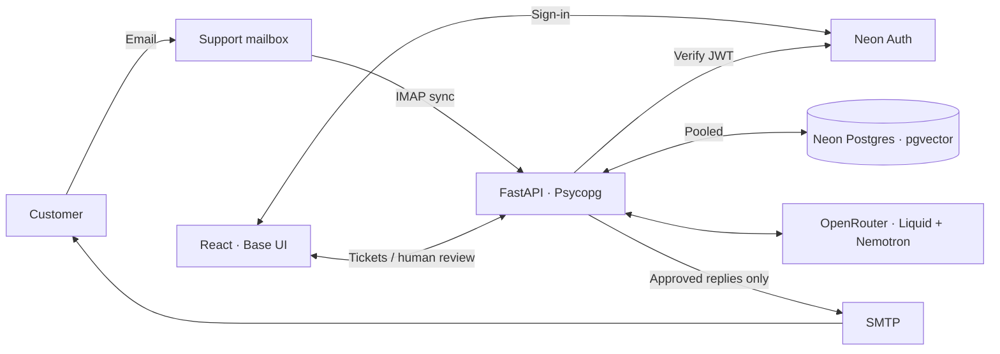

# Support Copilot

A support workspace with human-approved replies.

| Area | What works |
| --- | --- |
| Mail | IMAP → tickets, threaded SMTP replies, deduplication |
| Knowledge + AI | PDF/URL/text imports, document revisions, native-token chunks ≤512, source-backed drafts |
| Agent workspace | Split inbox, Cmd/Ctrl+K, J/K navigation, N/R shortcuts, server-side draft autosave |
| Automation | Ordered assignment rules, business hours/holidays, advance in-app SLA alerts |
| Quality | First-response/resolution times, SLA compliance, single-use customer surveys |



## Run

Requires Docker Compose and configured Neon Postgres/Auth + OpenRouter. Secrets stay in the ignored `.env`; use [.env.example](.env.example) for every setting.

```sh
cp -n .env.example .env
# Fill Neon connection/Auth URLs, OPENROUTER_API_KEY and BOOTSTRAP_ADMIN_EMAIL.
docker compose up --build -d --wait
docker compose exec api python -m app.seed       # optional fictional policies
```

Migrations run automatically through the direct database URL. Keep app data in `test-db` and managed Auth in `neondb`. First admin: register and verify `BOOTSTRAP_ADMIN_EMAIL`; authorize teammates in **Settings**.

**[App :8080](http://localhost:8080)** · **[Outgoing mail :8025](http://localhost:8025)** · **[API docs :8000](http://localhost:8000/docs)**

Try an incoming email locally; it appears as a ticket on the next sync:

```sh
docker compose exec api python -m app.mail_demo
```

**Real mailbox:** set `MAIL_DELIVERY_MODE=smtp`, real `IMAP_*`/`SMTP_*` credentials with TLS, and an HTTPS `PUBLIC_APP_URL`; apply with `docker compose up -d`. Supply your mail account, authenticated sender domain and public hosting. Defaults use GreenMail + Mailpit: no external mail is sent.

## Verify

Node 24+; backend tests use disposable PostgreSQL, never the live Neon database.

```sh
npm --prefix frontend ci
npm run build && npm --prefix frontend test
docker compose --profile test run --build --rm tests
```

**Limits:** single workspace; text-layer PDFs only; email attachments stay in the mailbox. Full AI history is capped at 100 KB, never silently truncated; private notes never reach AI or email. AI output is strictly validated, without retries or fallback. Providers may retain inputs: use synthetic or explicitly authorized data.
