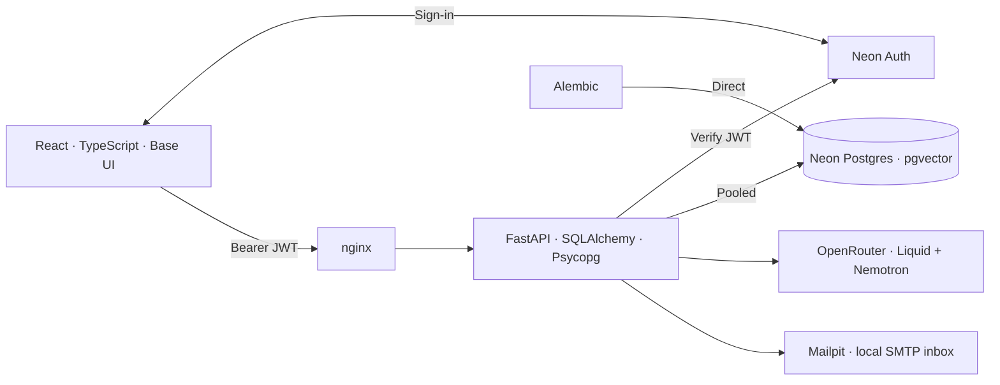
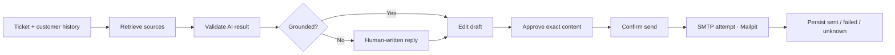

# Support Copilot

A human-reviewed support workspace. **Single workspace, local hosting, synthetic data only.**

| Area | Implemented |
| --- | --- |
| Access | Neon Auth, verified email, Agent/Admin roles, immediate member suspension |
| Inbox | Search, assignment/priority/intent/SLA filters, sorting, private saved views |
| Conversations | Customer messages, private notes, editable drafts, explicit approval and sending |
| Copilot | Source-backed drafts, intent/priority suggestions, abstention and escalation advice |
| Operations | Configurable 24/7 SLA targets, actor history, version-conflict protection |
| Knowledge | Text/Markdown indexing, duplicate detection, inspectable immutable sources |

## Architecture



Docker runs web, API and Mailpit. App data uses `test-db`; managed Auth uses `neondb`. Database, AI and SMTP credentials stay server-side.

## Review workflow



Notes never reach AI or email. Uncertain delivery blocks retries; SMTP acceptance is not proof of external inbox delivery. SLA starts at ticket creation; policy edits affect new tickets and explicit priority changes. Reopening keeps original deadlines.

## Run

Requires Docker Compose, Neon Postgres/Auth and an OpenRouter key.

```sh
cp -n .env.example .env
# Fill the ignored .env privately, then:
neon deploy --no-env-pull
docker compose up --build -d --wait
docker compose exec api python -m app.seed
```

Set `DATABASE_URL` (pooled), `DATABASE_URL_UNPOOLED` (direct), `OPENROUTER_API_KEY`, `NEON_AUTH_BASE_URL` and `BOOTSTRAP_ADMIN_EMAIL`. Keep TLS options and the app database name; `MIGRATION_DATABASE_URL` optionally overrides the migration connection. See [.env.example](.env.example).

Register and verify the bootstrap email in the app. Admins authorize teammates in **Settings**; no invitation email is sent. Seed adds fictional policies and demo assignees, not login accounts.

**[App](http://localhost:8080)** · **[Mailpit inbox](http://localhost:8025)** · **[API docs](http://localhost:8000/docs)**

## Verify (Node 24+)

```sh
npm --prefix frontend ci
npm --prefix frontend test
npm run build

docker compose --profile test build tests
docker compose --profile test run --rm tests
```

[GitHub CI](.github/workflows/ci.yml) runs the session regression, build and backend suite. Backend tests use disposable PostgreSQL/pgvector, signed test JWTs and controlled provider/SMTP boundaries—never the live Neon database.

## Boundaries

- SMTP is captured locally; customer messages are logged manually. No external email delivery, inbound email sync, public hosting or multi-tenancy is configured.
- `liquid/lfm-2.5-embedding-350m:free`: **512 tokens/input**, 1024 dimensions; inputs may be retained for training. Long conversations fail explicitly, without truncation.
- `nvidia/nemotron-3-ultra-550b-a55b:free`: strictly validated JSON; no automatic retries, repair or model fallback. Citations prove provenance, not correctness.
